# Creative Automation Pipeline


A proof of concept that turns **one campaign brief** into **localized, on-brand social ad creatives** for every market, product and aspect ratio, using GenAI only where an asset is missing.

**See it:**

<p align="center"><a href="https://github.com/mayoalexander/creative-automation-pipeline/releases/download/v1.0/creative-kit-demo.mp4">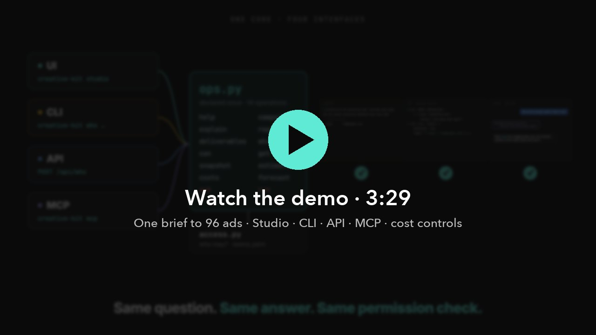</a></p>

- **[Demo video (3:29)](https://github.com/mayoalexander/creative-automation-pipeline/releases/download/v1.0/creative-kit-demo.mp4)**: the architecture, the code, the four creative types, the Studio, the four interfaces, setup, and cost controls. Narrated; every screen is real output.
- **[Creative Studio (live, read-only)](https://heyiris.io/s/OrcP2fRi5mbu1HR3PvLDnPta4vXDMtMLmesUfMEl)**: every campaign, market, creative and approval from the last real run, plus the configuration and who owns each part.
- **Edit it yourself:** `creative-kit studio` serves the same Studio on localhost with editing, checked by team permissions and audited ([how it works](#editing-in-the-browser-the-studio)).
- **Use it four ways:** the same operations through the Studio, the `creative-kit` CLI, an HTTP API and MCP for Claude ([one core, four interfaces](#one-core-four-interfaces-ui--cli--api--mcp)).

The same workflow is built **three ways**, against **one shared contract** (same config in, same files out, checked by the same tests):

| Engine | What it shows | Run it |
|---|---|---|
| **1. `vanilla`** | The pipeline from scratch: plain Python, Pillow, stdlib HTTP | `creative-kit run spring-launch` |
| **2. `langgraph`** | The same pipeline on open-source frameworks: **LangGraph** orchestration + **Pydantic** validation, parallel fan-out, retries, human approval | `python -m engines.langgraph run --campaign spring-launch` |
| **3. `iris`** | The same workflow running in production on **IRIS**: Atlas workspace, typed dataset of every creative, per-market approval cards, agent review | `python -m engines.iris run --campaign spring-launch` |

```
 1 brief × 4 markets × 2 products × 4 creative types × 3 ratios = 96 localized ads — 96/96 brand checks
```

**Real output** (OpenRouter: Gemini for product shots, FLUX for people; supplied photos reused):

| Product | Influencer | UGC | Poster |
|---|---|---|---|
|  |  | 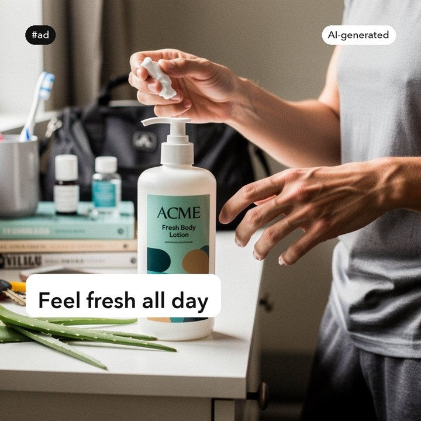 |  |

One brief, four markets (message localized, Japan with its own logo, partner switched off, disclaimer):

| US | Mexico | Japan | Germany (translated at run time) |
|---|---|---|---|
|  |  |  | 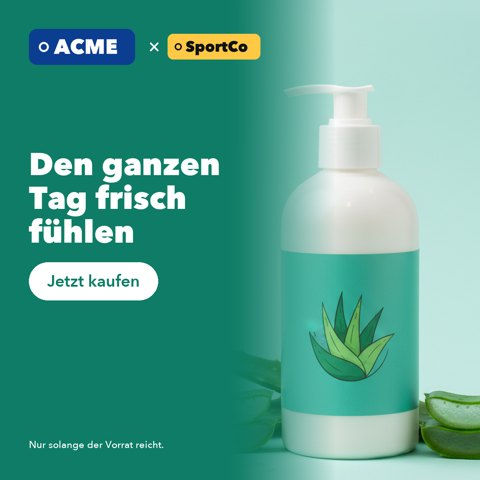 |

Same creative, three ratios (the layout changes per ratio; 9:16 keeps copy inside the Stories safe zones):

| 1:1 | 9:16 | 16:9 |
|---|---|---|
| 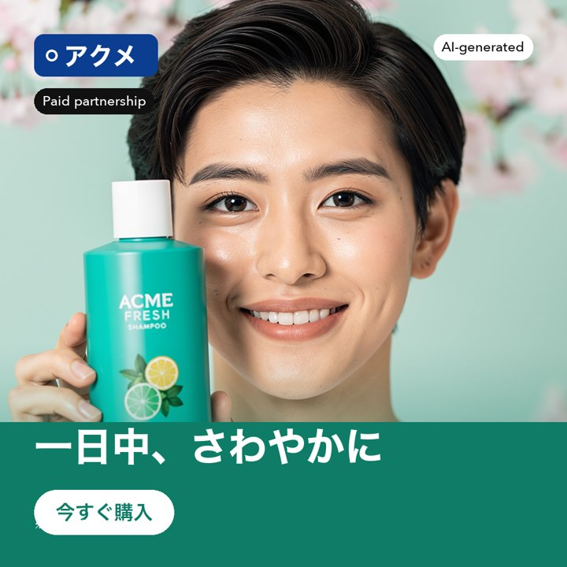 | 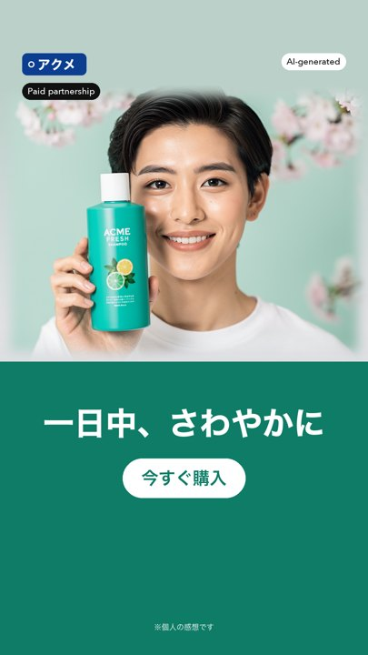 | 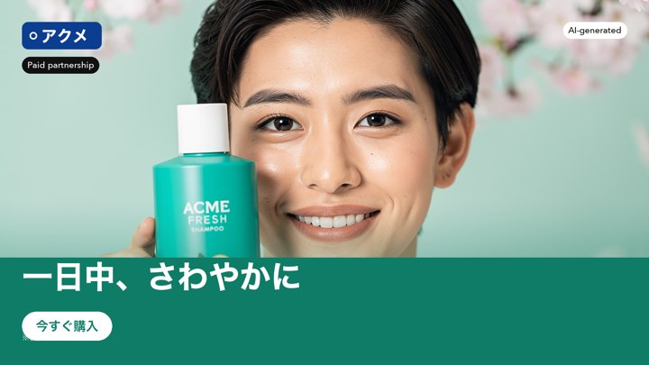 |

Newsletter channel, parent brand (Acme blue, no partner), same engine:


---

## Quick start

**1 · Install** (Python 3.10+, with [uv](https://docs.astral.sh/uv/) or plain pip)

```bash
git clone https://github.com/mayoalexander/creative-automation-pipeline
cd creative-automation-pipeline
uv venv && uv pip install -e .  # or: python3 -m venv .venv && .venv/bin/pip install -e .
source .venv/bin/activate       # puts the `creative-kit` command on your PATH
```

Rather not activate the venv every time? Add these to `~/.zshrc` or `~/.bashrc` (`ckit` is the short name):

```bash
alias creative-kit="$PWD/.venv/bin/creative-kit"
alias ckit="$PWD/.venv/bin/ckit"
```

**2 · Run it** (offline, no API key)

```bash
creative-kit run spring-launch --provider mock  # 96 ads in output/vanilla/spring-launch/
creative-kit run summer-promo --provider mock   # Mexico is blocked by its legal rules: by design
```

**3 · Look around**

```bash
creative-kit                                                   # every command, read vs write
creative-kit campaigns                                         # what is configured
creative-kit explain spring-launch jp                          # which file set each value for Japan
creative-kit deliverables summer-promo --status blocked_legal  # what legal stopped
creative-kit who markets/jp.yaml overrides.acme.legal          # who may change Japan's legal rules
creative-kit studio                                            # the dashboard, on http://localhost:8765
```

<p align="center">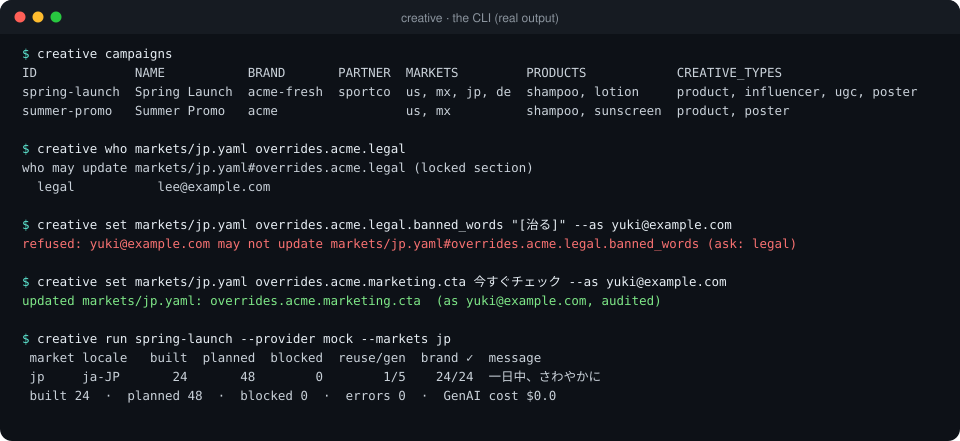</p>

**4 · Real images** (optional): one key in `.env`. Images already generated are reused for $0.

```bash
cp .env.example .env            # OPENROUTER_API_KEY=...  (or OPENAI_API_KEY=...)
creative-kit run spring-launch  # images + translation via OpenRouter
```

**5 · Use it from Claude** (optional): open the repo in Claude Code and the [`.mcp.json`](.mcp.json) offers the
`creative-kit` server. Or add it to Claude Code from anywhere:

```bash
claude mcp add creative-kit -e PIPELINE_USER=yuki@example.com -- \
    "$PWD/.venv/bin/creative-kit" mcp --config "$PWD/config" --out "$PWD/output"
```

Then ask in plain words: *"Which Spring Launch markets are blocked, and why?"* or *"Change Japan's call to
action to 今すぐチェック and re-run Japan with the mock provider."*

**Tests:** `uv pip install -r requirements-dev.txt && python -m pytest -q` (38 tests, all three engines, offline).

<details><summary>More commands: subsets, plan-only, the LangGraph and IRIS engines</summary>

```bash
creative-kit run summer-promo --provider mock                             # a market-specific legal block (Mexico)
creative-kit run spring-launch --markets jp,mx                            # subset of markets
creative-kit run spring-launch --plan-only                                # resolve + legal check only
creative-kit run spring-launch --provider openai                          # gpt-image-1 direct
creative-kit run spring-launch --env-file ~/.my/env                       # keys from another file
python -m engines.langgraph run --campaign spring-launch --provider mock  # asks you to approve each market
python -m engines.langgraph run --campaign spring-launch --auto-approve
python -m engines.langgraph graph                                         # pipeline as a Mermaid diagram
python -m engines.iris      run --campaign spring-launch --provider mock  # dry run: prints the IRIS commands
python -m engines.iris      run --campaign spring-launch --publish        # writes to an IRIS workspace
python -m engines.iris      sync-approvals --campaign spring-launch       # pull approver ticks back
```

`creative-kit` (short: `ckit`) is the same as `python -m engines.vanilla`, which works without installing.
</details>

---

## Example input

The brief only says **what** and **where**. **Who** (audience, locale, local rules) lives in market files, and **how** (logo, colours, legal, tone) lives in brand files. The brief references them by id.

```yaml
# config/campaigns/spring-launch.yaml
id: spring-launch
name: Spring Launch
brand: acme
sub_brand: acme-fresh
partner: sportco
message: Feel fresh all day
localized_messages:
  es-MX: Frescura todo el día
  ja-JP: 一日中、さわやかに          # de-DE omitted -> translated at run time
products:
  - { id: shampoo, name: Acme Fresh Shampoo,     description: a teal shampoo bottle ... }
  - { id: lotion,  name: Acme Fresh Body Lotion, description: a white pump bottle ... }
markets: [us, mx, jp, de]
channels: [social]
```

```
config/
├── org.yaml              operating parameters: regions, velocity target, creative resources, approvers
├── brands/               acme.yaml (global) · acme-fresh.yaml (sub-brand, parent: acme)
├── partners/             sportco.yaml (co-brand logo, its own legal words, its own approver)
├── markets/              us · mx · jp · de — locale, audience, overrides, influencers, affiliate program
├── channels/             social (built) · newsletter · print · partnership · sponsorship · event
└── campaigns/            spring-launch · summer-promo
assets/
├── brands/acme/logo.png              global logo
├── markets/jp/logo.png               Japan's katakana lockup (market override)
├── markets/jp/products/shampoo.png   Japan's localized product shot (beats the global one)
├── products/shampoo.png              global product shot
└── (lotion missing)                  -> generated, then cached in assets/generated/
```

## Example output

```
output/vanilla/spring-launch/
├── report.json         totals, per-market breakdown, time saved, GenAI cost
├── plan.json           every deliverable: built / planned / blocked_legal / error
├── run.log
├── jp/
│   ├── approvals.json  approvers (teams) for this market + decision
│   ├── influencers.json
│   ├── shampoo/social/{product,influencer,ugc,poster}/static/{1x1,9x16,16x9}.png
│   └── lotion/social/{product,influencer,ugc,poster}/static/{1x1,9x16,16x9}.png
├── mx/ · us/ · de/
```

```
──────────────────────────────────────────────────────────────────────────
 SPRING-LAUNCH  ·  engine: vanilla  ·  provider: openrouter
──────────────────────────────────────────────────────────────────────────
 market locale   built  planned  blocked  reuse/gen  brand ✓  message
 us     en-US       24       48        0        6/0    24/24  Feel fresh all day
 mx     es-MX       24       48        0        6/0    24/24  Frescura todo el día
 jp     ja-JP       24       48        0        6/0    24/24  一日中、さわやかに
 de     de-DE       24       48        0        6/0    24/24  Den ganzen Tag frisch fühlen
──────────────────────────────────────────────────────────────────────────
 built 96  ·  planned 192 {'video': 96, 'gif': 96}  ·  blocked 0  ·  errors 0
 images reused 24  ·  generated 0  ·  brand checks 96/96
 run 21.2s  ·  manual ≈ 72.0h  ·  saved ≈ 72.0h  ·  GenAI cost $0.0
──────────────────────────────────────────────────────────────────────────
```

(Every image here was reused from earlier runs, so this run cost $0. German had no line in the brief and was translated at run time; Spanish and Japanese came from the brief.)

---

## How it works

<p align="center">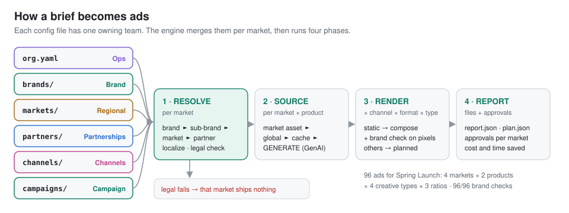</p>

<details><summary>The same, as text</summary>

```
   org.yaml ─ brands/ ─ partners/ ─ markets/ ─ channels/ ─ campaign.yaml
                                 │
   1. RESOLVE  (per market)      ▼
      global brand ► sub-brand ► market overrides ► partner (if active here)
      localize message  ►  legal check (blocks the market if it fails)
                                 │
   2. SOURCE   (per market × product, in parallel)
      market asset ► global asset ► previously generated ► GENERATE (GenAI)
                                 │
   3. RENDER   (per market × product × channel × format × asset type)
      static ──► compose + brand check on the pixels
      video / gif / sound / vector ──► written to the plan as "planned"
                                 │
   4. REPORT   report.json · plan.json · approvals.json · influencers.json
```

</details>

---

## Key design decisions

**1. Markets are their own objects; the brief references them.**
Region, locale, audience, local assets and local rules live in `markets/<id>.yaml`. A brief lists market ids. Adding a market is one file and no code; every campaign can reuse it; each regional team owns its own file. This meets the "brief includes region and audience" requirement by reference instead of by copying.

**2. Discovery questions are input parameters.**
How many regions, the velocity target, creative resources and who approves in each market are `org.yaml`, not meeting notes. The same engine serves a different client by swapping config.

**3. Brand hierarchy with merge rules.**
Precedence: `global brand ► sub-brand ► market override ► partner`. Each section has a rule:

| Section | Rule | Why |
|---|---|---|
| assets, marketing | **override** | a market can swap its logo or CTA |
| legal, compliance | **add-only** | a market can make rules stricter, never looser |
| partner | can be switched **off** per market | SportCo isn't a partner in Japan |

**4. Legal checks fail closed, per market.**
A banned word blocks that market only; the others still ship (`summer-promo`: Mexico's translation says *garantizada*, which Mexico's own list bans, so MX is blocked and US ships). Latin words match on word boundaries (*cure* ≠ *secure*); CJK terms match as substrings.

**5. Brand checks run on the rendered pixels, not on intentions.**
Logo present (pixel comparison against the logo's opaque area), band colour equals the brand primary, headline/band contrast ≥ WCAG AA 4.5:1, headline didn't shrink below a readable size.

**6. The product is never cropped.**
The source is contained in the area above the text band, over a blurred cover of itself, with feathered edges. One 1:1 source serves 1:1, 9:16 and 16:9 without cutting the product out of frame (a brand-safety choice over a tighter crop).

**7. Reuse before generate, and cache what you generate.**
Most specific asset wins (market ► global). Generated images are cached by a hash of provider + prompt, so re-runs and other campaigns don't pay twice (second run: 0 generated, 8 reused).

**8. GenAI is a pluggable provider.**
`openai` (gpt-image-1), `openrouter` (Gemini image, FLUX and others behind one key) or `mock` (offline, deterministic, used by tests). The prompt is built from the product plus the market's audience and the brand's tone.

**9. Channels and asset types are a registry; the core doesn't change.**
Six channels are configured; **social** and **newsletter** render today. `video`, `gif`, `sound`, `vector` are declared by channels and written to `plan.json` as `planned`, so the client sees the full scope of the campaign. Adding one is a YAML file plus one generator.

**10. Same contract, three engines.**
`tests/test_contract.py` runs every engine on the same config and asserts identical output paths and totals.

### Why LangGraph for engine 2
What the framework adds is orchestration, not pixels:
- **Pydantic** validates the config tree before any API spend (`campaign spring-launch: unknown market 'fr'`, `brands.acme-fresh.assets.colors.primary: String should match pattern…`).
- **`Send`** fans sourcing and rendering out in parallel (measured on the first version: 24 creatives in 1.4 s vs 8 s sequential, mock provider; see the stress test for scale).
- **`RetryPolicy`** on the GenAI node.
- **`interrupt`** pauses at a per-market approval gate; decisions are written to `approvals.json`.
- **Checkpointing**: a paused or failed run resumes without regenerating finished work.

Rendering and merge rules are shared with engine 1 on purpose.

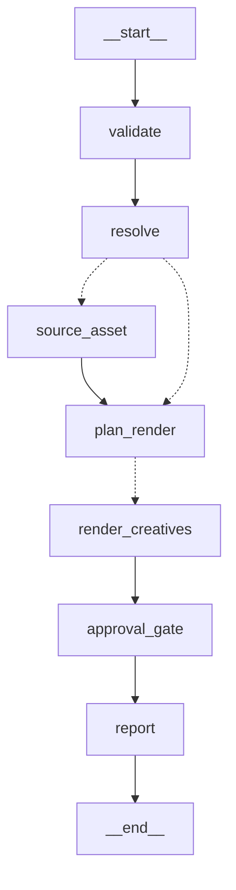

### Why IRIS for engine 3
Engines 1 and 2 produce files. In production the campaign needs a place to live: who approves what, what shipped, what's blocked, what's working. Engine 3 runs the same core and makes IRIS the system of record:

| IRIS piece | Use | Pain point / goal |
|---|---|---|
| **Atlas board** per campaign | workspace with Approvals and Runs lists | decentralised process (P2) |
| **Dataset `creative-assets`** | every creative as a typed record, upserted by `external_id` so re-runs don't duplicate | insights at scale (G5, P4) |
| **Approval card per market** | one checklist task per approver, previews attached; `sync-approvals` reads the ticks back | slow approvals (P3) |
| **Agent review** (`--agent <id>`) | an IRIS agent reviews each market's localized headline for tone and cultural fit | quality and brand voice (P2) |

It runs **dry by default**: it prints the exact `iris …` commands to `iris_commands.sh` and changes nothing, so the engine can be reviewed without an IRIS account. `--publish` executes them. Commands are run with an argv list (never a shell string), so quotes and Japanese text can't be re-split, and workspace state is saved after every step, so a failed run resumes on the same board.

Verified against a live workspace (first version, product shots only): 4 approval cards × 3 approver tasks, 72 dataset records (18 per market), 12 preview images; ticking Japan's three tasks and running `sync-approvals` moved JP to `approved` in both `approvals.json` and the dataset.

---

## One core, four interfaces: UI · CLI · API · MCP

The pipeline is headless. Every operation is declared once in [`engines/vanilla/ops.py`](engines/vanilla/ops.py)
(typed arguments and a docstring), and each interface is generated from that list:

<p align="center">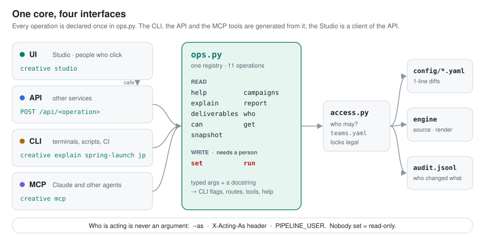</p>

| Operation | Reads or writes | What it does |
|---|---|---|
| `campaigns` | read | campaigns, with markets, products, channels and creative types |
| `explain` | read | which config file set each value for one market |
| `report`, `deliverables` | read | the last run's report and every deliverable (filter by market, status, type) |
| `who`, `can` | read | which teams may change a file or section; whether a person may |
| `config_get`, `snapshot` | read | one config file with its owners; everything the Studio shows |
| `config_set` | write | change one value: checked against `teams.yaml`, audited, undone if it breaks the config |
| `estimate` | read | what a run would cost before it runs: new vs cached images, against every budget cap |
| `costs`, `forecast` | read | spend this month by campaign, market, model, person and day; projected month-end |
| `run` | write | run a campaign (`provider=mock` is free; cached images cost $0); refused if over budget |

Same question, same answer, through any door (a test checks this):

```bash
creative-kit                                           # every command, by read / write
creative-kit help set                                  # arguments + a CLI, API and MCP example
creative-kit who markets/jp.yaml overrides.acme.legal  # who may change Japan's legal rules
creative-kit set markets/jp.yaml overrides.acme.marketing.cta 今すぐチェック --as yuki@example.com

creative-kit studio                                    # UI + API on :8765
curl -XPOST localhost:8765/api/who -d '{"path":"markets/jp.yaml","section":"overrides.acme.legal"}'
curl -XPOST localhost:8765/api/run -H 'X-Acting-As: carla@example.com' -d '{"campaign":"spring-launch","provider":"mock"}'

creative-kit mcp                                       # MCP over stdio
creative-kit mcp --http --host 0.0.0.0 --token $TOKEN  # MCP over HTTP, hosted
```

**With Claude Code:** the repo has a [`.mcp.json`](.mcp.json), so opening the repo in Claude Code offers the
`creative-kit` server. Its `help` tool is the same document as `creative-kit help`, and each
example in it is run by the tests, so the help can't drift from the code. Then ask in plain words: *"Which markets in Spring Launch are blocked, and why?"*,
*"Change Japan's call to action to 今すぐチェック and re-run Japan with the mock provider"*, *"Who do I ask to
change the German disclaimer?"*

**Who is acting is never an argument.** The CLI takes `--as`, the API the `X-Acting-As` header (the Studio's
picker), and MCP the `PIPELINE_USER` it was started with (set in `.mcp.json`). With nobody set, everything is
read-only, and every write is checked again by `access.py`. Read tools are marked read-only for MCP clients,
so they can be auto-approved; the two write tools ask first.

Local and hosted are the same code: `studio` and `mcp --http` bind to `127.0.0.1` by default. A hosted
copy would put them behind single sign-on and map each person's token to their `PIPELINE_USER`.

## Built for an FDE engagement

`creative-kit` is shaped the way a forward-deployed engineer would hand it to a customer:

| The customer's team | Owns | Uses |
|---|---|---|
| Brand, Legal, Regional, Partnerships, Channels, Campaigns | their own YAML files (`teams.yaml` says which) | the Studio, or `creative-kit set … --as them` |
| Ops / leadership | `org.yaml`: regions, velocity target, budget (with Finance), approvers | `creative-kit report`, the Studio overview |
| Their engineers | nothing new: it's config + a CLI | `creative-kit` in CI, `POST /api/<operation>` from their tools |
| Their agents | nothing new | `creative-kit mcp`: the same operations as tools |

What the FDE does per customer: point `assets/` at their DAM, write their brand, market and legal YAML with
each team, plug their image model in as a provider (one class in `providers.py`; Firefly would sit next to
OpenRouter and OpenAI), and connect approvals to where their reviewers already work (the IRIS engine shows
this with approval cards). The engine, the checks and the four interfaces don't change.

## Creative standards

`config/creative_standards.yaml` (owned by Brand) defines the kinds of creative a campaign can ask for:
`creative_types: [product, influencer, ugc, poster]`. Each type has a **shot** recipe (subject, setting, camera,
composition, filled in per product and market), a **treatment** (how it is finished), **rules** (what it must
carry) and optionally preferred **models**.

| Type | Image | Finish | Must carry |
|---|---|---|---|
| `product` | studio product shot; supplied photos win | brand panel, headline, button | — |
| `influencer` | a creator cast from the market's audience, holding the product | photo-led, brand at the bottom | "Paid partnership" + "AI-generated" |
| `ugc` | candid phone photo at home | native caption, no brand panel, no logo | "#ad" + "AI-generated", ≤ 40 characters |
| `poster` | reuses the product image (no extra generation) | the message is the hero | ≤ 32 characters |

Disclosure, the AI-person label and headline length are **brand checks**, so a missing "#ad" fails the build.
Models are a chain per type (preferred → org default → fallbacks): Gemini's safety filter refused a photo of a
person in testing, so people shots go to FLUX first and a refusal falls through with the reason kept. The cache key
is the prompt plus the first-choice model, so adding a fallback never throws away paid-for images.

## Teams and access control

One module (`engines/vanilla/access.py`) and one file (`config/teams.yaml`) handle multi-team ownership:

- **Teams** list their members; **grants** say which team may `read / create / update / delete` which config
  file, down to one **section** (`markets/jp.yaml#overrides.acme.legal`).
- **Protected sections** (legal, compliance) need a grant that names the section: the Japan team edits
  `markets/jp.yaml`, but not the legal rules inside it.
- Updates are checked **section by section** and appended to an audit log; a refused edit writes nothing.
- **Approvers are team ids**, so "who signs off" and "who may edit" come from one list, and `who()` routes a
  hand-off to the people on the owning team.

```bash
creative-kit who markets/jp.yaml overrides.acme.legal                                        # who may change it
creative-kit can markets/jp.yaml overrides.acme.legal --user yuki@example.com                # may NOT
creative-kit set markets/jp.yaml overrides.acme.marketing.cta 今すぐチェック --as yuki@example.com  # checked, audited
```

### Editing in the browser: the Studio

```bash
creative-kit studio          # http://localhost:8765
```

The same dashboard as the hosted page, built from the live config and the last run, with editing:

- Pick who you are acting as (a member from `teams.yaml`). Fields you may change get a pencil; locked
  sections show the team that owns them. The server checks every save again with `access.py`.
- A save changes **one line** of the YAML file and keeps its comments, so the git diff is reviewable. It is
  written to `audit.jsonl` and shown under *Teams & access → Recent changes*.
- A save that would break the config (say, a campaign naming a market that doesn't exist) is undone and
  the reason is shown.
- **Re-run** re-renders the campaign so you can see the change on the ads. Text edits reuse cached photos ($0).

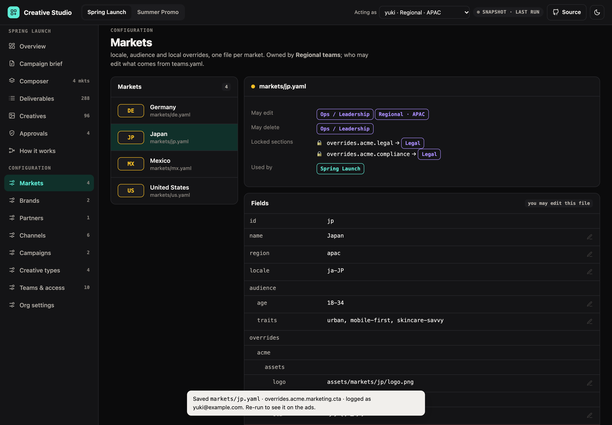

Standard library HTTP on `127.0.0.1` only: it is a local tool with no login. "Acting as" is a picker, not
authentication; a hosted version would take the user from SSO and keep the same checks.

## Cost and budget controls

Every image a run sources is written to `spend.jsonl` (next to `config/`, not in git): who ran it, which
campaign, market and model, whether it came from the cache, and what it cost. The mock and cached images cost $0.
The budget lives in `org.yaml#budget`: a monthly cap for the org, optional caps per campaign and per market, and
what to do when a run would go over (`block` or `warn`). It is a locked section: only Ops and Finance may change it.

```bash
creative-kit estimate spring-launch                      # new vs cached images, the cost, and whether it fits
creative-kit run spring-launch --as carla@example.com    # checks the same estimate first; over a cap, it is refused
creative-kit costs                                       # this month: by campaign, market, model, person, recent runs
creative-kit forecast                                    # daily rate, projected month-end, the day it hits the budget
creative-kit set org.yaml budget.per_campaign_usd.spring-launch 50 --as olivia@example.com
```

A refused run generates nothing and names the cap and its owners:
`over budget: would take spring-launch to $52.00 of its $50.00 cap (ask: ops, finance, who own org.yaml#budget)`.
Ops or Finance can push one run through with `--allow-over-budget`; anyone else is refused. `estimate` exits 4
when a run would not fit, so a script can stop on it. API and MCP callers go through the same check, and the
Studio's *Costs & budget* page shows the same numbers. `python -m engines.vanilla.costs backfill` seeds the
ledger once from the image cache (`assets/generated`); those lines are marked `"source": "backfill"`.

## Stress test

`python scripts/stress.py --scales 4x2,10x4,25x6 --engine vanilla|langgraph` builds a synthetic enterprise from
the real config and runs the real engine offline (image generation time is modelled at the measured ~6 s/image).

| markets × products | creatives | vanilla | langgraph | peak memory (vanilla / langgraph) |
|---|---|---|---|---|
| 4 × 2 | 24 | 5.2 s | 3.3 s | 227 / 565 MB |
| 10 × 4 | 120 | 22.7 s | 8.3 s | 388 / 820 MB |
| 25 × 6 | 450 | 82.8 s | 30.4 s | 523 / 1136 MB |

Rendering is linear (~0.19 s/creative sequential, ~0.07 s in parallel). What breaks first at enterprise scale:
**GenAI time and cost** (one image per market × product, because the prompt carries the market's audience:
100 × 20 = 2,000 images ≈ 50 min at 4 workers, ~$80; the budget caps now stop a run before it overspends),
**LangGraph memory** (every item lives in graph state and the in-memory checkpointer, roughly doubling vs vanilla)
and **sequential translation** in the resolve phase. The fixes are known: share hero images across markets with
the same audience, stream items out of graph state, and translate in parallel.

## Assumptions and limitations

- **Input assets** are local PNGs; storage is the local filesystem. Swapping in S3/Azure/Dropbox means replacing `find_asset` and the output writer.
- **One source image per product per market**; all ratios are composed from it. A production version would generate ratio-native hero images for 9:16 and 16:9.
- **Translation** uses an LLM only when the brief has no localized line; offline it falls back to English and the report flags it (`EN fallback`). Production would add human linguistic review.
- **Legal checks** are word lists, not legal review. They catch known-bad phrasing; they don't judge claims.
- **Brand checks** confirm logo, colour, contrast and size on our overlay; they don't judge the generated image itself. In the real run the model printed "ACME FRESH" on the bottle despite "no text, no logos" in the prompt. A production version would add a vision check (OCR or a VLM) on the source image before composing.
- **Influencers** come from config and are marked `verified: false`; discovery against social APIs is out of scope.
- **Fonts** default to Arial Unicode (macOS) with Linux fallbacks; set `brand.assets.font` for production.
- Only **static** is rendered; video/gif/sound/vector are planned, not produced.
- No performance-data loop yet (CTR/conversions back into the dataset), which is the next step for goal 4.

---

## How I used AI

AI was a tool here and I'm accountable for every line.

- **Mine:** the architecture and the decisions above. Starting from discovery (regions, locales, velocity, resources), separating markets from the brief, turning discovery questions into input parameters, the global/sub-brand/partner hierarchy overridable by market, the channel and asset-type registry, influencers/affiliates per market, and building the same workflow three ways against one contract.
- **AI-assisted (Claude Code):** scaffolding, boilerplate (HTTP wrappers, CLI parsing, report formatting), sample config and assets, first drafts of tests and this README.
- **How it was checked:** every engine runs offline against the mock provider; 44 tests cover merge precedence, add-only legal rules, word-boundary matching, approvals, validation, access control, creative-standard rules, model fallback, budget enforcement, the four interfaces and the cross-engine contract; rendered output was reviewed visually and fixed where it didn't hold up (text-band layout, hard-edged product paste, an over-clever report line, a wrong test expectation); the IRIS engine was verified against a live workspace by reading the records back, not by trusting exit codes.
